# vCommander

vCommander is a desktop GUI application that helps create, populate and tear down Verkada Command organizations with a few clicks instead of hours of point-and-click management and cleanup. This tool is built on [Flet](https://flet.dev/), and ships three tools behind a single Verkada Command login.

<p align="center">
  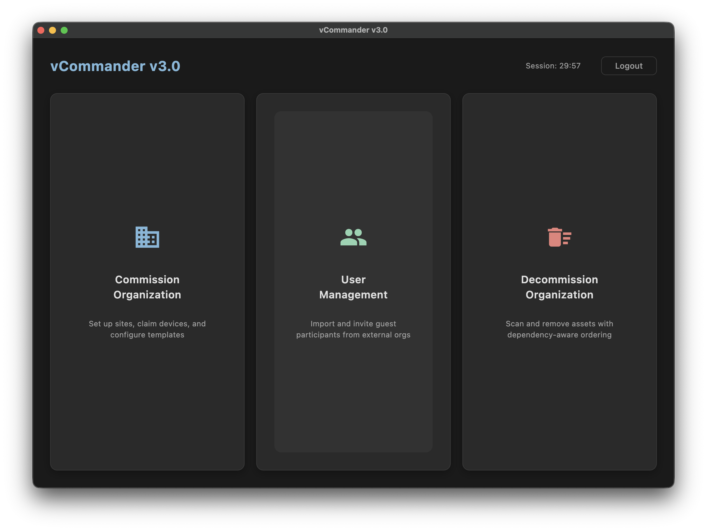
</p>

---

## Table of Contents
 
- [What is vCommander?](#what-is-vcommander)
- [Who is this for?](#who-is-this-for)
- [The Three Tools at a Glance](#the-three-tools-at-a-glance)
- [Quick Start](#quick-start)
- [Developers Setup Guide](#developers-setup-guide)
- [Detailed Usage Guide](#detailed-usage-guide)
  - [Logging In](#logging-in)
  - [Commission Tool](#commission-tool)
  - [Users Invite Tool](#users-invite-tool)
  - [Decommission Tool](#decommission-tool)
- [Per-Template Walkthroughs](#per-template-walkthroughs)
- [Supported Assets (Decommission)](#supported-assets-decommission)
- [Where Data Lives](#where-data-lives)
- [Configuration](#configuration)
- [Developer Details](#developers-details)
  - [Architecture](#architecture)
  - [API Clients](#api-clients)
  - [Deletion Order](#deletion-order)
- [Troubleshooting & FAQ](#troubleshooting--faq)
- [Security Considerations](#security-considerations)
- [Disclaimer](#disclaimer)
- [License](#license)

---

## What is vCommander?

vCommander is a desktop application that automates the most tedious parts of running a Verkada Command organization at scale — especially the kind of bulk setup and teardown that happens around **Verkada Certified Engineer (VCE) training sessions**, demos, and lab environments.
 
Instead of clicking through dozens of pages in Command to add 40 cameras, invite 30 students, or wipe a lab org clean after a class, vCommander lets you do all of it from a single login screen, with progress bars, and in a few minutes.
 
It runs as a native window on macOS, Windows, and Linux. You log in with your normal Verkada Command credentials (MFA supported), pick a tool, and go.

## Who is this for?

| You are… | This tool helps you… |
|---|---|
| 🎓 A Verkada training instructor | Reset student lab orgs to a clean slate between classes. |
| 🤝 A Verkada partner or SE | Quickly stand up a demo org with a realistic device mix. |
| 🛠️ An admin who inherited a messy org | Inventory and selectively delete sprawl in one pass. |
| 👨‍💻 A developer | Extend the templates, deletion order, or API clients for your own internal automation. |

## The Three Tools at a Glance

vCommander bundles three tools behind a single login. Pick whichever you need from the home screen.
 
| Tool | What it does | When to use it |
|---|---|---|
| 🚀 **Commission** | Spins up a brand-new org from a template — sites, buildings, cameras, panels, controllers, and supporting users. | Before a training session or demo, when you need a populated org fast. |
| 📩 **Users Invite** | Pulls guest-visit participants from another Verkada org and invites them to your current org. | When you need to onboard a roster of trainees who already visited as guests. |
| 🔥 **Decommission** | Inventories every asset in the org and lets you tick the ones you want gone. Deletes them in dependency-safe order. | After a training class — wipe the lab clean for the next group. |
 
---

## Quick Start

### Step 1 — Download the app
 
1. Go to the [**Releases** page](https://github.com/not-mehul/vCommander/releases).
2. Find the latest release at the top.
3. Download the file that matches your computer:
   - **macOS** → `vCommander.app.zip` (or similar `.dmg` / `.zip`)
   - **Windows** → `vCommander.exe` or `vCommander-windows.zip` (unavailable)
   - **Linux** → see the [developer setup](#quick-start--for-developers) below (unavailable)
4. Unzip the file.
5. Drag `vCommander.app` (macOS) or the executable (Windows) into your **Applications** folder (or anywhere convenient).

> [!WARNING]
> **macOS first-launch warning:** macOS may say *"vCommander cannot be opened because the developer cannot be verified"* or *"the app is damaged"*. This is normal for apps not distributed through the App Store. To fix it:
> - **Right-click** the app and choose **Open** (don't double-click). You'll get a different prompt that lets you continue.
> - If you see *"app is damaged"*, open Terminal and run: `xattr -cr /Applications/vCommander.app`
 
### Step 2 — Launch the app and log in
 
1. Double-click **vCommander** to launch it. A login window will appear.
2. Enter your login info:
   - **Email** — the email you use to sign into Verkada Command.
   - **Password** — your Verkada Command password.
   - **Org Short Name** — the part before `.command.verkada.com` in your Command URL. For example, if you log in at `acme-training.command.verkada.com`, your short name is `acme-training`.
3. Click **Login**.
4. You'll be prompted for a code from SMS or your authenticator app. Enter it.

> [!TIP]
> Your credentials are saved locally so you don't have to retype them next time. Your password lives only on your computer — it's never uploaded anywhere except Verkada itself.
 
### Step 3 — Pick a tool
 
You'll land on a home screen with three buttons. Click the one you need. See the [Detailed Usage Guide](#detailed-usage-guide) below for what each tool does step-by-step.
 
---

## Developers Setup Guide

If you want to run vCommander from source, modify it, or build your own packaged version, follow the standard Python project flow.

### Prerequisites
 
- **Python 3.10+** (the codebase uses PEP 604 `X | None` typing).
- **OS:** macOS, Windows, or Linux. Flet runs as a native desktop window.
- **Flet 1.0.x** — pinned in `requirements.txt` (`flet>=1.0.5,<1.1`). On first launch Flet downloads its desktop runtime if it isn't installed yet.
- **A Verkada Command account** with **Org Admin** rights on the target org.
- **Network access** to `vglobal.global-prod.verkada.com` (org lookup), your org's shard hosts (`*.command.verkada.com`, `*.prod-us-ohio.verkada.com`, … — see [Shards](#shards-and-regions)) and your org's public API host (`api.verkada.com`, `api.oh.verkada.com`, `api.eu.verkada.com` or `api.au.verkada.com`).

### Install from source
 
```bash
# 1. Clone the repo
git clone https://github.com/not-mehul/vCommander.git
cd vCommander
 
# 2. Create and activate a virtual environment
python -m venv .venv
source .venv/bin/activate          # Windows: .venv\Scripts\activate
 
# 3. Install dependencies
pip install -r requirements.txt
 
# 4. Run it
python main.py
```

## Detailed Usage Guide

### Logging In
 
The login screen captures three fields plus an optional 2FA step. There is no shard or region to pick: vCommander looks the org short name up first and routes everything to the shard it lives on (see [Shards](#shards-and-regions)). An unknown short name is flagged on the field before any credentials are sent.
 
| Field | What to enter | Example |
|---|---|---|
| Email | Your Verkada Command admin email | `you@company.com` |
| Password | Your Verkada Command password | — |
| Org Short Name | The subdomain of your Command URL | `acme-training` |

<p align="center">
  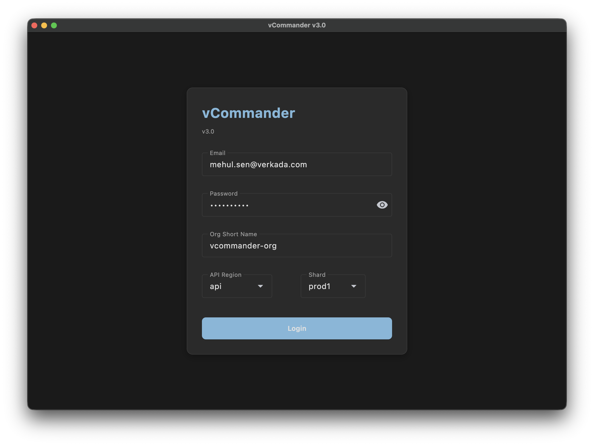
  &nbsp;
  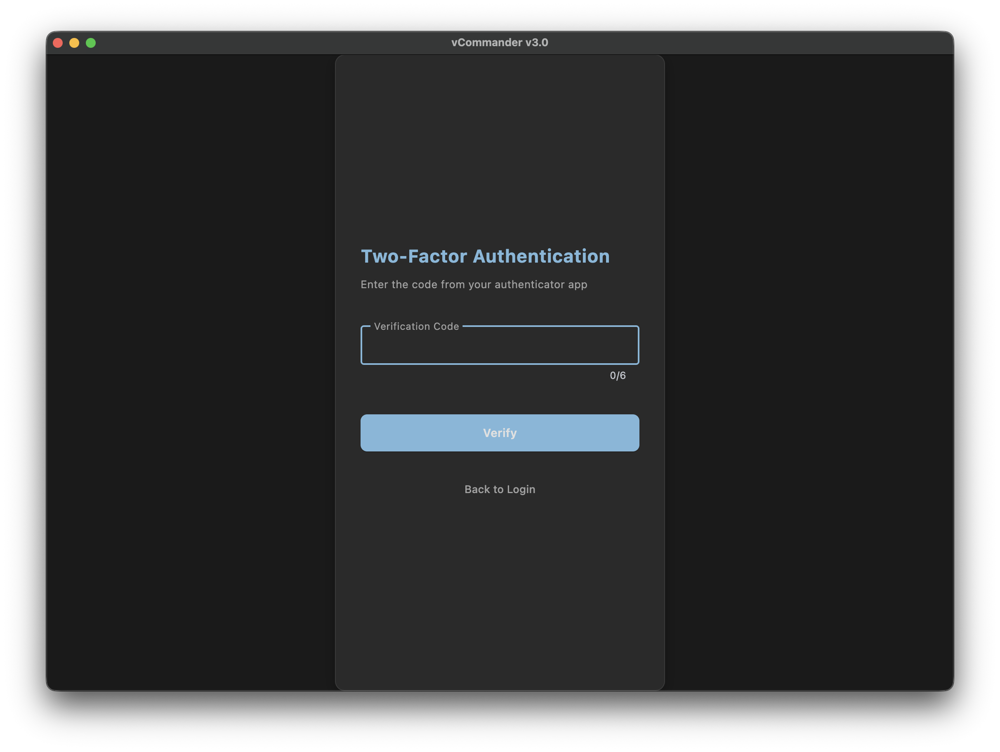
</p>
 
After successful login (and 2FA), you land on the **home screen** with the three tool tiles.
 
> ⏱ **Session timeout:** You'll be logged out automatically **30 minutes after login** (configurable in `constants.py` via `SESSION_TIMEOUT_MINUTES`). The clock is a fixed window measured from login — moving between tools does not reset or extend it — and it's enforced even while you're inside a tool or the window is in the background. A warning appears 5 minutes before logout.

> ⌨ **Keyboard shortcuts:** `Esc` backs out of the current screen; **Cmd/Ctrl-K** opens the command palette (jump to a tool, switch theme, log out); **Cmd/Ctrl-,** logs out. `Enter` submits the active form (login, 2FA).

> 🛑 **Cancel a long run:** Commission and Decommission both expose a **Cancel** button while a run is in progress. Cancellation is cooperative — the in-flight API call is allowed to complete (so no device is ever left half-deleted), and the next step is skipped. Decommission then shows a summary of what was done vs. what was skipped.

> 🚧 **Leaving during a run:** while a commission, decommission scan/delete, or invite batch is running, navigating away, pressing `Esc`, switching theme, or logging out first asks whether to stop it. Choosing **Stop and continue** cancels the run (as above) before leaving. If your session expires mid-run, the run is cancelled too — it never keeps going in the background.
 
### Commission Tool
 
Spins up a populated org from a template.
 
**Steps:**
 
1. **Pick a template** from the dropdown:
   | Code | Display Name | Devices Created |
   |---|---|---|
   | `ESS` | Essentials | Dome, Alarm Panel, Access Station Pro |
   | `ACSL` | Access Control Specialist - Lab | Access Station Pro |
   | `ACSE` | Access Control Specialist - Exam | Disable Global Site Admin; optionally (on by default) first remove every other user's organization, user management and site roles, keeping Org Admin |
   | `VSSL` | Video Security Specialist – Lab | Bullet, PTZ, Command Connector, Access Controller, License Plate |
   | `VSSE` | Video Security Specialist – Exam | Dome, Fisheye, Bullet |
   | `AS` | Alarms Specialist | Dome, Access Controller, Alarm Panel, Keypad |
2. *(Optional)* **Pick a kit** from `assets/kits.csv` — this auto-fills device serials so you don't have to type them in.
3. **Review/override** the device serials and the supporting-user list inline if needed.
4. Click **Review** to see a summary of what will be created, then **Commission Organization**. Watch the progress — sites, buildings, devices, and users are created in dependency-safe order, and the report lists any failed step.

The run uses only the internal API (no public-API key). Devices are claimed with one batch call, and supporting users already in the org are reported rather than re-invited.

<p align="center">
  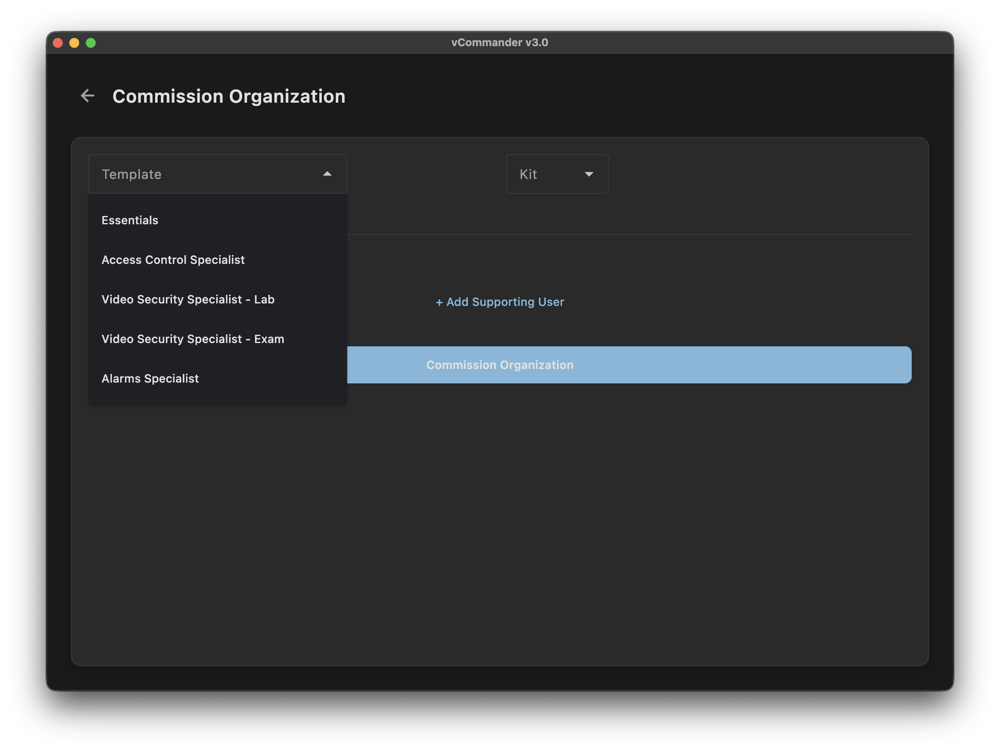
  &nbsp;
  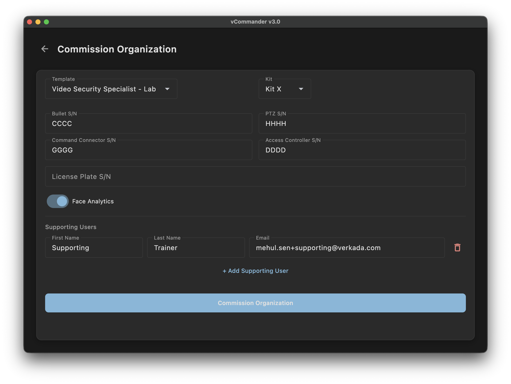
</p>

> 💡 Selecting a kit auto-fills every serial-number field — handy when you're cycling through the same hardware between classes.

### Users Invite Tool
 
Bulk-invites users to your current org by pulling them from another org's **guest visits** in a date range.
 
**Steps:**
 
1. **Connect to a source org** — enter its short name and a Verkada **public-API key** (generate one in the source org's Command settings). vCommander looks up the source org's region itself; it can differ from the org you're logged in to.
2. **Pick a site and a date** — vCommander fetches the guest-visit participants who checked in at that site on that day.
3. **Review the list** — you can edit names and emails inline, or remove rows you don't want to invite. Malformed emails are flagged before anything is sent. Use **Back** on steps 2 and 3 to change the site/date or the source org without starting over.
4. **Send invites** — invitations are sent against the org you're logged into, and (unless you turn it off in step 3) everyone in the run — invited now or already in the org — is added to an **All Participants** Command group and an **All Participants** access group. Both are created the first time and reused afterwards; a re-run adds only the people not yet in them. In a VSSL org they also join **VCE Access Group**, and the templates' access levels are granted to their group: **[DO NOT TOUCH] AF64** (ESS) to All Participants, **VCE Access Level** (VSSL) to VCE Access Group. Creating the access group needs an access admin role: any you lack are granted for that step and revoked right after. A copy-able summary at the end breaks down successful vs. failed invites.

<p align="center">
  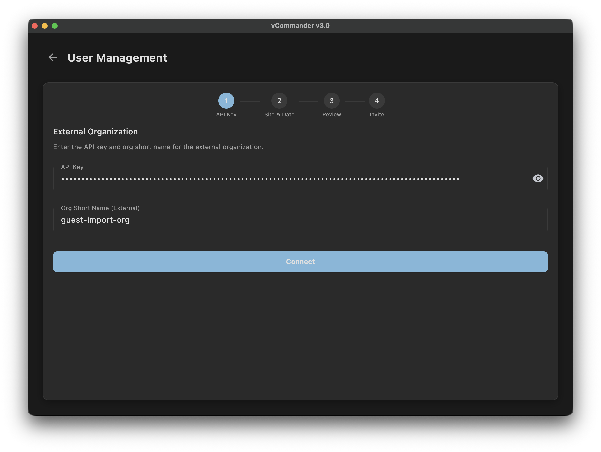
  &nbsp;
  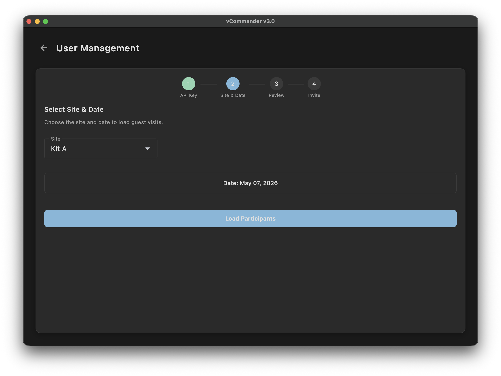
</p>
<p align="center">
  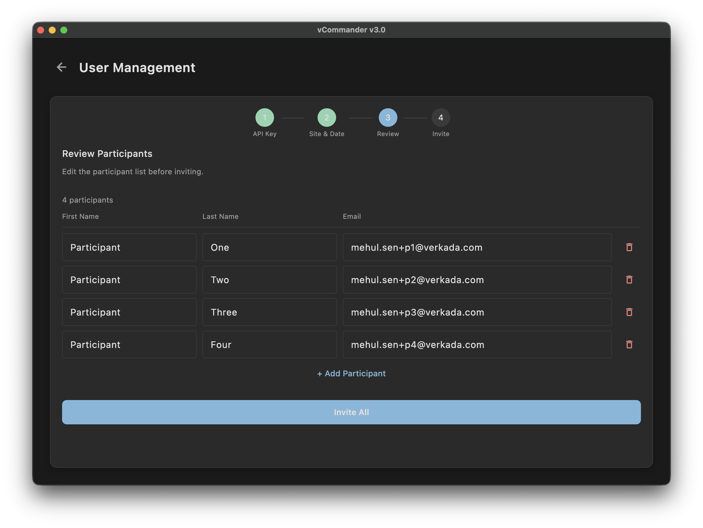
  &nbsp;
  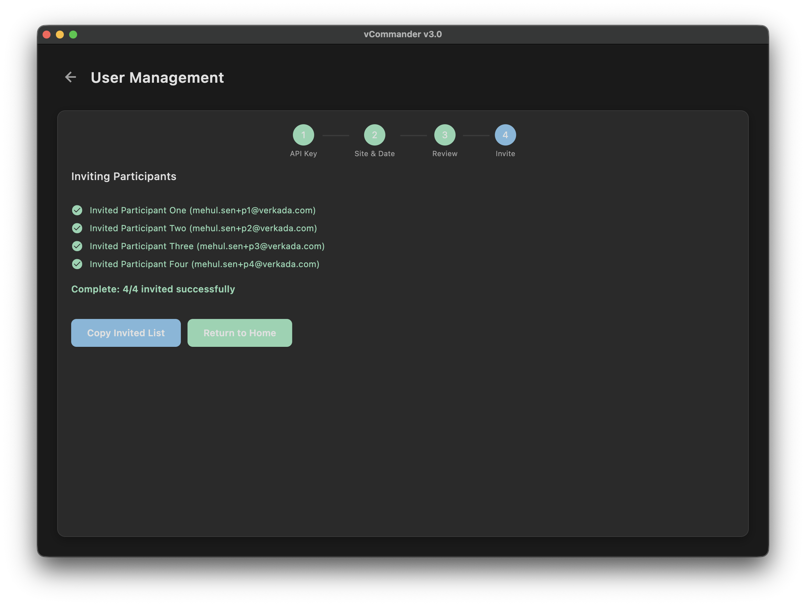
</p>

### Decommission Tool
 
Inventories the entire org, lets you select what to wipe, then deletes it all in dependency-safe order.

> [!CAUTION]
> **The Decommission Tool is destructive**. It deletes users, devices, sites, and configurations and the operation **cannot be undone**. Always review the inventory carefully before confirming deletion. **Do not run this tool against a production org** unless you intend to wipe it completely.
 
**Steps:**
 
1. **Start Scan** — vCommander walks through the org and lists every asset, grouped by category with counts. Embedded devices (like cameras inside intercoms) are automatically deduplicated.
2. **Review** — check the per-category counts.
3. **Select** — everything deletable starts ticked. Untick whole categories, or turn on **Show items** to tick individual assets. **Search** filters by name, serial or id; while a search is active, *Select all* / *Select none* apply only to the matching items, so you can build a selection from a search.
4. **Confirm** — the summary lists exactly what will be deleted (e.g. *"3 of 40"* for a partly selected category). Click **Delete N Assets** and watch deletion progress.
5. **Results** — see a summary of successful vs. failed deletions, plus the cleanup steps. Copy the report or export it as CSV.

<p align="center">
  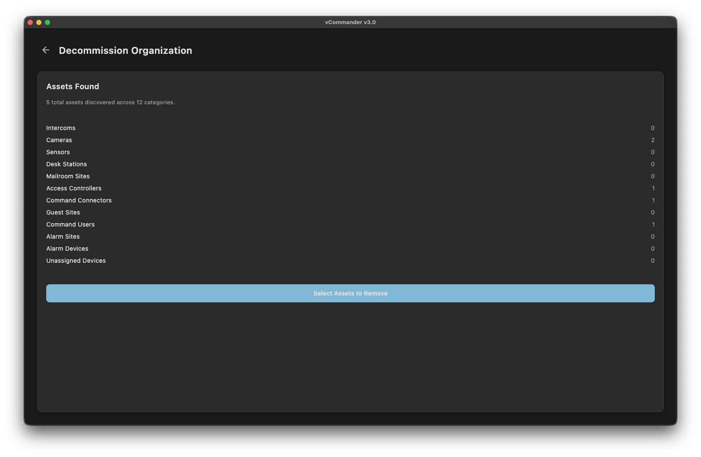
  &nbsp;
  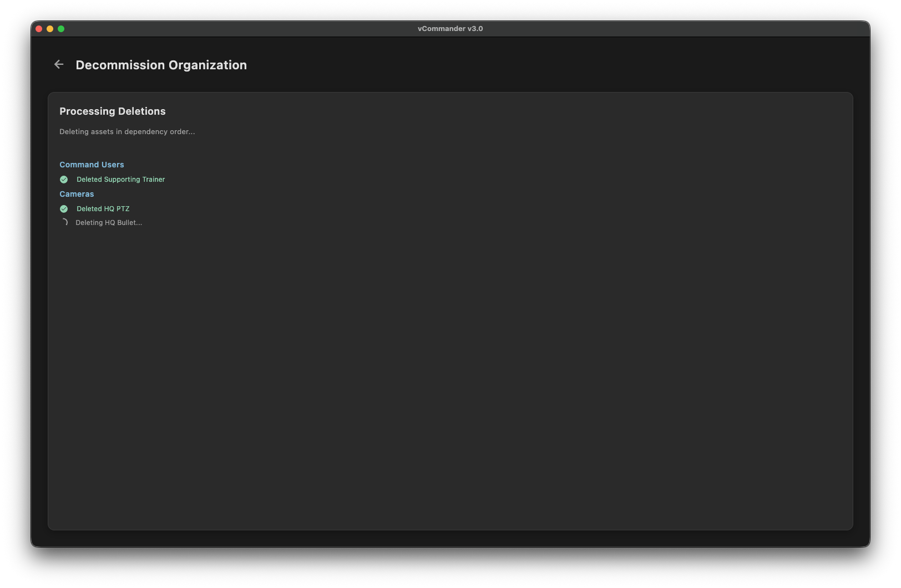
</p>

> 🛡 **Safety net:** Nothing is deleted until you both tick boxes *and* confirm on the Confirm step. Only ticked assets are deleted.

> 🔐 **What the scan changes, and how it's undone:** to see every site-scoped asset, the scan turns on **Global Site Admin** (an org-wide setting) and grants your user whichever of **Access System Admin** and **Access User Admin** it lacks. When the flow ends — after a delete run with any outcome, a failed or cancelled scan, or when you leave the screen after scanning — Global Site Admin is turned back off and both Access Admin roles are revoked, including ones you held before (Command grants them to whoever claims an access controller, so a commissioned org leaves them behind). Decommission uses only the internal API; no API key is created.

> 📄 **Large orgs:** Visits, Visitors, Archives and Incidents list at most 99 items per scan (shown as `99+`). If you delete a whole category, vCommander re-lists it after each pass and keeps deleting until none are left. Persons of interest are fully paginated; cameras and users list up to 1,000 each.
 
---

## Per-Template Walkthroughs

Each template provisions a different shape of org, and a matching decommission cleans up exactly what was created. The pairs below show what a successful run looks like end-to-end — handy for verifying your output, or sanity-checking what's about to disappear.

### Essentials (`ESS`)

A minimal org with a camera, an alarm panel, an Access Station Pro (with a face-unlock door), and a guest site — useful for quick demos. Decommission removes the camera, alarm devices, the Access Station Pro and its door, and the guest site.

<p align="center">
  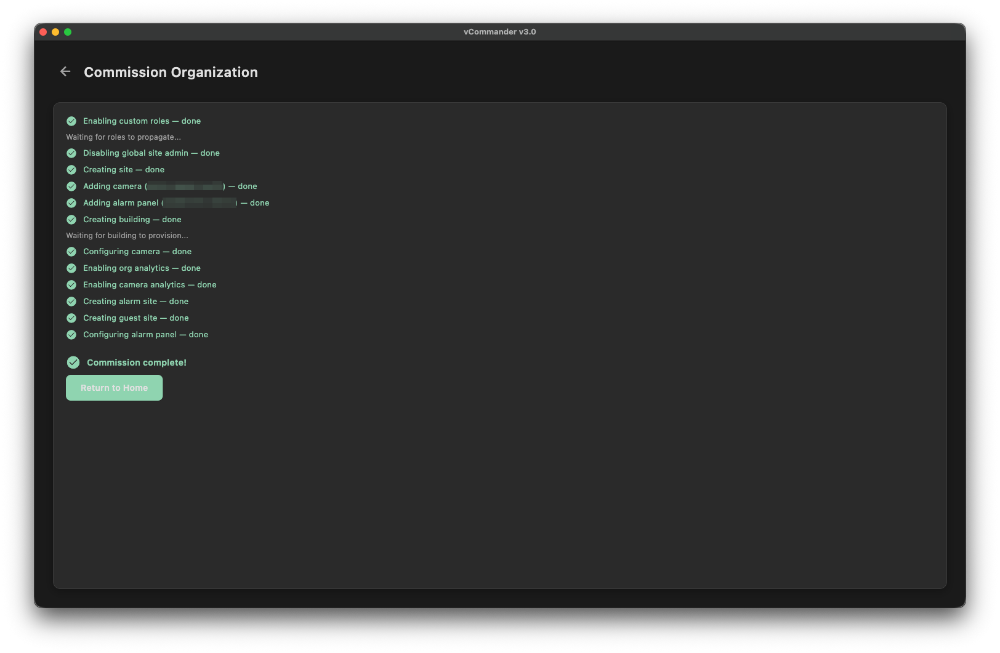
  &nbsp;
  
</p>

### Access Control Specialist – Lab (`ACSL`)

One Access Station Pro (AF64) on an `HQ` site and building, with org face-unlock enabled, a door on the station with face unlock and card + code / face + card / face + code multi-factor modes, and a 24/7 two-factor door schedule. Decommission removes the door, the schedule, the Access Station Pro, the building and the site.

### Access Control Specialist – Exam (`ACSE`)

The lightest template — only enables custom roles and disables global site admin. No physical devices are claimed, so there's nothing for the Decommission tool to clean up afterward.

<p align="center">
  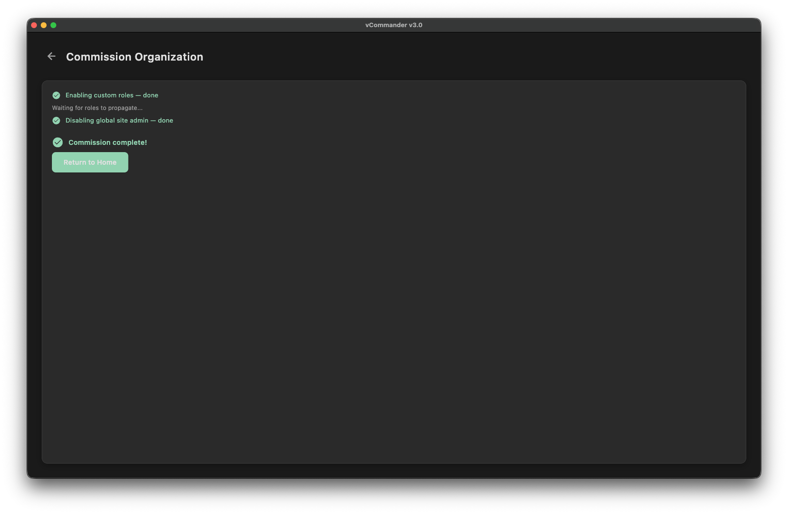
</p>

### Video Security Specialist – Lab (`VSSL`)

The full lab build: bullet, PTZ, command connector, access controller, with LPR + face analytics enabled and access groups, levels, and users provisioned. Decommission walks back through users, cameras, the connector, and the access controller in dependency order.

<p align="center">
  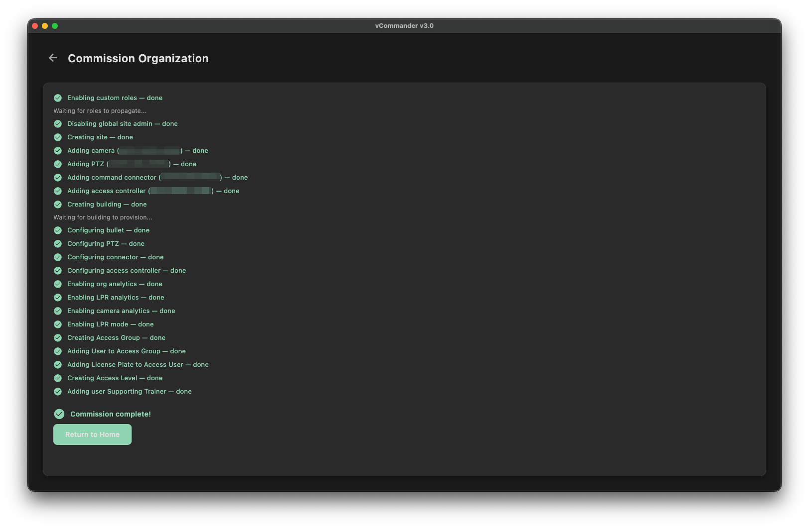
  &nbsp;
  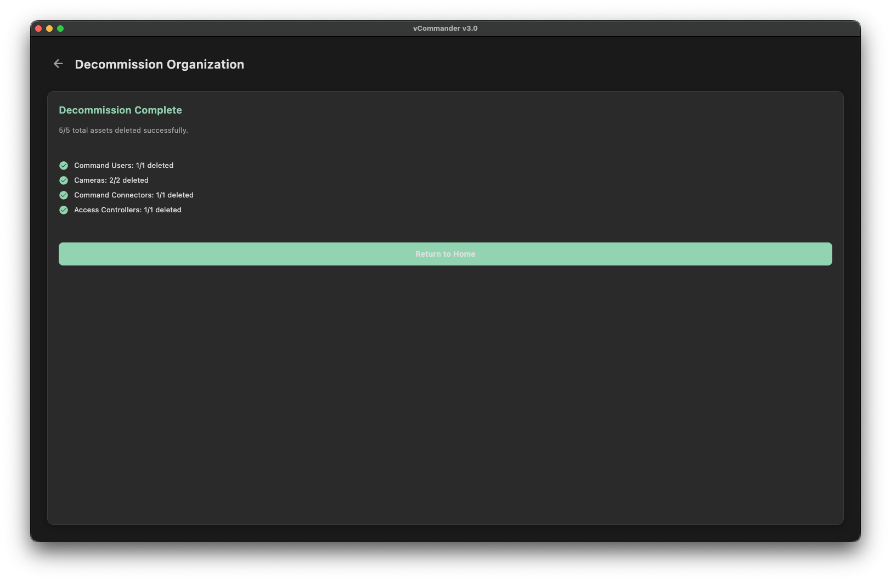
</p>

### Video Security Specialist – Exam (`VSSE`)

Three cameras (dome, fisheye, bullet) with org-wide LPR analytics and camera analytics turned on. Decommission removes all three cameras.

<p align="center">
  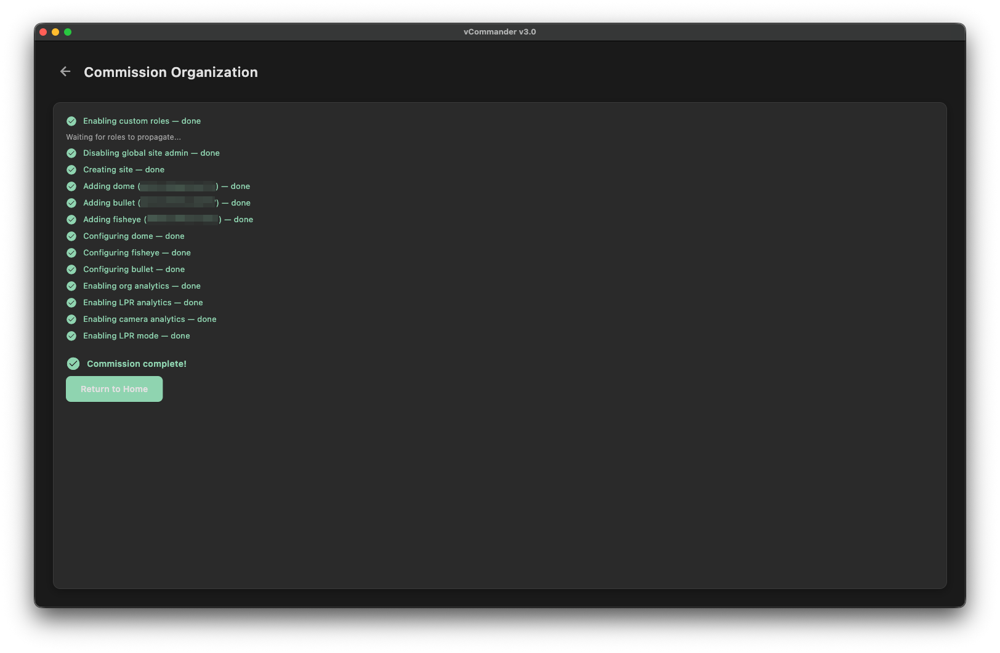
  &nbsp;
  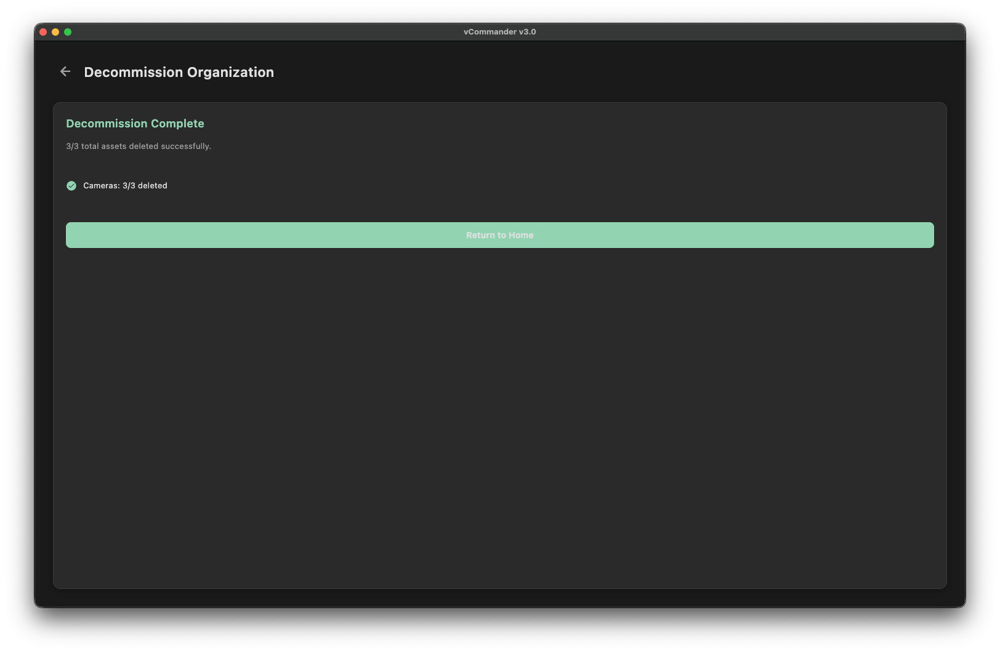
</p>

### Alarms Specialist (`AS`)

Camera + access controller + alarm panel + keypad, plus a configured alarm site, a general instructor keycode, and a strobe light on panel output pin 1. The access controller is only used to create the `HQ 24/7 Access` level and is decommissioned again during the run. Decommission removes the camera, the alarm devices and outputs, and the alarm system and site.

<p align="center">
  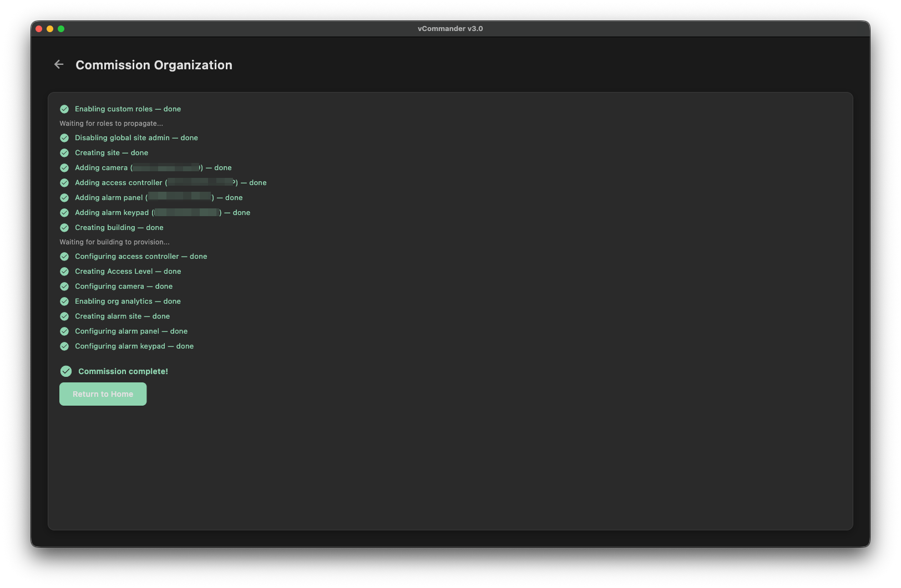
  &nbsp;
  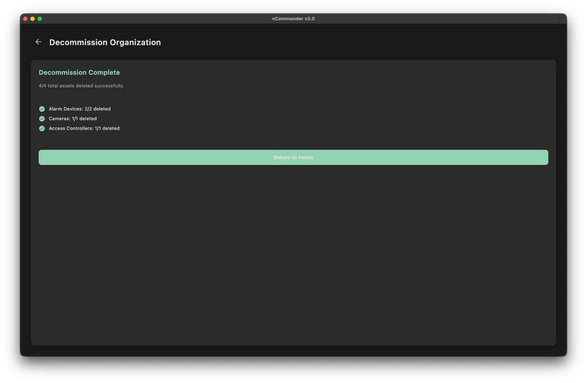
</p>

> 📋 If your run finished without "Commission complete" or "Decommission Complete" at the top of the report, open the API call log (see [Where Data Lives](#where-data-lives)) and look for the failing step — the missing line in the log will line up with whichever step is missing from the screenshots above.

---

## Supported Assets (Decommission)
 
The Decommission tool can delete:

- Users: Visits, Visitors, Command Users (the user running the tool is never listed), Groups
- Intercoms
- Desk Stations
- Environmental Sensors
- Cameras and Persons of Interest
- Command Connectors
- Incidents, Archives (footage from the last 7 days), Alerts
- Guest Sites
- Mailroom Sites
- **Access Control:** Doors, Access Station Pro, Access Controllers, Floors, Buildings, Visitor Access Templates, Schedules, Access Levels, Access Groups, Scenarios
- **Alarms:** Keypads, Expanders, Wireless Contact Sensors, Wireless Panic Buttons, Wireless Universal Transmitters, Wired Inputs, Wired Outputs, Guards, Partitions, Panels, Systems, Sites
- Sites (camera groups — deleted last; if a site refuses deletion it is renamed `<name>-<mm/dd/yy>` so the name is freed for reuse)

The Access Control and Alarms categories are grouped under collapsible parent tiles in the selection step — the parent checkbox toggles all of its children at once. Each asset row shows its name, serial number (where the device has one), and object id, and the same detail is written per-deletion to `api_calls.log`.
> ℹ️ **Read-only category:** "Unassigned Devices" appears in the inventory (marked read-only, without a checkbox) but cannot be deleted — Verkada does not expose a delete endpoint for those — and is never counted in the Confirm total.

See the [Per-Template Walkthroughs](#per-template-walkthroughs) section above for examples of what a successful decommission summary looks like for each template.
 
---

## Where Data Lives
 
vCommander stores a small amount of state on your machine — no cloud, no telemetry.
 
| File | Contents |
|---|---|
| `<data_dir>/vcommander.db` | Saved login + Users-tool import settings (SQLite). |
| `<data_dir>/prefs.json` | UI preferences (light/dark theme). |
| `<data_dir>/api_calls.log` | One line per API call, with timestamp. |
 
Where `<data_dir>` lives:
 
- **macOS** — `~/Library/Application Support/vCommander`
- **Windows** — `%APPDATA%\vCommander`
- **Linux** — `${XDG_DATA_HOME:-~/.local/share}/vCommander`
> 🧹 **To reset saved credentials:** delete `vcommander.db`. The app will start fresh on next launch.
 
---

## Configuration
 
Everything user-tunable lives at the top of [`constants.py`](constants.py):
 
| Constant | Default | Purpose |
|---|---|---|
| `APP_VERSION` | `3.5` | Shown in the title bar and used in API key names. |
| `GITHUB_REPO` | `not-mehul/vCommander` | Repo polled for the auto-update banner. |
| `DEV_SKIP_LOGIN` | `False` | Set `True` to bypass auth and land on Home (dev only). |
| `MIN_WIDTH` / `MIN_HEIGHT` | 1100 × 800 | Window minimum size. |
| `SESSION_TIMEOUT_MINUTES` | `30` | Minutes after login before auto-logout (fixed window, not reset by navigation). |
| `SESSION_WARNING_MINUTES` | `5` | When to show the "session ending" warning. |
| `SESSION_EXTENSION_MINUTES` / `SESSION_MAX_EXTENSIONS` | `15` / `2` | Size and number of "Extend session" grants. |
| `ESS_*` / `VSSL_*` / `AS_*` … | HQ data | Default site/building/address constants per template. |
| `TEMPLATE_FIELDS` | — | Add/remove devices that a template asks for. |
| `DELETION_ORDER` | — | Order in which categories are deleted — **dependency-sensitive, edit with care.** |
| `READ_ONLY_CATEGORIES` | `Unassigned Devices` | Scanned and shown, never selectable or deleted. |
| `PAGED_CATEGORIES` / `INTERNAL_PAGE_SIZE` | 4 categories / `99` | One-page list endpoints that decommission re-lists until empty. |

### Auto-Update Check
 
On launch, vCommander checks the latest published GitHub Release and shows a dismissible dialog if a newer version is available. You can ignore it, but you'll get the most reliable behavior on the latest release since Verkada's internal APIs occasionally shift.
 
---

## Developer Details
 
### Architecture
 
```
vCommander/
├── main.py                  # Flet entry point, navigation + run guard
├── constants.py             # Template + decommission tables, session/API settings
├── theme.py                 # Design tokens + light/dark palettes
├── requirements.txt
├── pyproject.toml           # ruff + pytest configuration
├── apis/
│   ├── endpoints.py         # Endpoint registry + URL builders (resolve/build_url)
│   ├── http.py              # Shared requests.Session (safe retries + default timeout)
│   ├── internal_api.py      # VerkadaInternalAPIClient (Command internal API)
│   └── external_api.py      # VerkadaExternalAPIClient (apidocs.verkada.com)
├── components/              # Buttons, inputs, cards/banners, stepper, progress rows, Cmd-K palette
├── pages/
│   ├── app_shell.py         # Persistent sidebar shell + session timer; ToolView base
│   ├── login_view.py        # /login
│   ├── two_factor_view.py   # /2fa
│   ├── home_view.py         # /home – tool picker
│   ├── commission_view.py   # /commission
│   ├── users_view.py        # /users
│   └── decommission_view.py # /decommission
├── utils/
│   ├── cancellation.py      # Cooperative CancellationToken
│   ├── db.py                # SQLite credentials + import-settings store
│   ├── executor.py          # Shared ThreadPoolExecutor (4 workers)
│   ├── export.py            # CSV report export to ~/Downloads
│   ├── logger.py            # Append-only API call log
│   ├── prefs.py             # Theme preference (JSON)
│   ├── session.py           # Auth state, session clock, active-run registry
│   ├── tasks.py             # GC-safe background tasks
│   ├── ui_utils.py          # Toasts, alerts, confirm dialogs
│   ├── validation.py        # Device serial mask/validation
│   └── version_check.py     # GitHub release version check
├── tests/                   # pytest suite (run in CI)
├── tools/shoot_app.py       # Headless screenshot harness for UI review
└── assets/
    ├── kits.csv             # Editable device-serial presets
    ├── templates.csv        # Informational template list
    └── icon.png / icon.icns
```
 
`main.py` configures the Flet `Page` and owns navigation. Login and 2FA are standalone views; the tools are hosted in one persistent `AppShell` (sidebar + content area) that swaps only its content when you switch tools. Every view receives a single `push_route(route)` callback so it can navigate without importing the others.

All navigation, theme switches and logout go through a **run guard**: long-running jobs register themselves in `utils/session.py`, and the guard asks before abandoning one, cancelling it cooperatively if you continue. When the shell swaps a tool out it calls the tool's `on_leave()` hook — Decommission uses it to undo the scan's org changes.

### Running the tests

```bash
pip install -r requirements.txt pytest ruff
ruff check .
pytest
```

The suite runs without network access or a display (views are driven with a stub page and fake API clients) and stores its data in a temporary directory. GitHub Actions runs the same commands on Python 3.10 and 3.13 for every push and pull request. Flet deprecation warnings fail the suite (see `pyproject.toml`), so an API that a newer Flet is about to remove shows up in CI before it can break the app.

### Previewing screens

`tools/shoot_app.py` serves a single screen, in a chosen state and theme, to a browser — handy for reviewing UI changes without logging in:

```bash
pip install "flet-web>=1.0.5,<1.1"
SHOT_VIEW=decommission SHOT_STATE=select SHOT_THEME=light SHOT_PORT=8700 python tools/shoot_app.py
# then open http://127.0.0.1:8700
```

`SHOT_VIEW` is one of `login`, `twofa`, `home`, `commission`, `decommission`, `users`; see the script for each view's states.
 
### API Clients
 
**`VerkadaInternalAPIClient`** (`apis/internal_api.py`)
- Mimics browser behavior using session cookies and CSRF tokens.
- Accesses internal/private APIs for comprehensive device management.
- Handles login, MFA verification, and privilege escalation.
- Every request goes to the org's shard: `https://<service>.<shard domain>/__v/<org>/…` (see below).
**`VerkadaExternalAPIClient`** (`apis/external_api.py`)
- Uses the standard public API endpoints documented at [`apidocs.verkada.com`](https://apidocs.verkada.com).
- Automatic token generation (refreshed on 401/403) and full pagination of list endpoints.
- Used only by the Users tool, to read the source org's guest sites and visits with the API key you enter.
Commission and Decommission use only the internal client. Independent calls run four at a time, and a Decommission scan sends each identical read once.

Both clients share `apis/http.py`: every request has a default timeout, and transient failures are retried — but a `POST` (create site, claim device, invite user) is only retried when the server provably did nothing (connection never opened, or HTTP 429), so a retry can never create a duplicate.

### Shards and regions

Command orgs are hosted on separate shards (`prod1`, `prod2`, `prod-ap-syd`, `prod-us-ohio`, …), each with its own host names. Before logging in, vCommander calls `org/validate_short_name` on the global `vglobal.global-prod.verkada.com` service. The response names the org's shard and its host metadata, and the client builds every URL from it:

| From the lookup | Used for | `prod-us-ohio` example |
|---|---|---|
| `shard.name` | `shard` in the login request | `prod-us-ohio` |
| `host_metadata.domain` | every internal service: `https://<service>.<domain>` | `vprovision.prod-us-ohio.verkada.com` |
| `host_metadata.api_gateway_endpoint` | gateway endpoints (registered with subdomain `api`) | `api.prod-us-ohio.verkada.com` |
| `shard.name` | the public API host: `prod1` → `api.verkada.com`, `prod-us-ohio` → `api.oh.verkada.com`, `prod2` → `api.eu.verkada.com`, `prod-ap-syd` → `api.au.verkada.com` (an unknown shard falls back to its `readable_name` region) | `api.oh.verkada.com` |

`host_metadata.public_api_endpoint` is not the public API's host: Command sets it to `apiadmin` (the API-key service) on every shard, so vCommander ignores it.

The endpoint paths and payloads are the same on every shard; only the hosts differ. The resolved org name and shard are shown in the sidebar. Before an org is resolved (and for the dev login bypass) the client falls back to `prod1` on `command.verkada.com`.

### Deletion Order
 
To prevent dependency errors, the Decommission tool deletes assets in this fixed order (configurable via `DELETION_ORDER` in `constants.py`):

1. **Users:** Visits → Visitors → Command Users (the user running the tool is excluded) → Groups
2. Doors → Access Station Pro (both are also surfaced by the camera endpoint, so they go before Cameras)
3. Intercoms
4. Desk Stations
5. Sensors
6. Cameras → Persons of Interest
7. Command Connectors
8. Incidents → Archives → Alerts
9. Guest Sites
10. Mailroom Sites
11. **Access Control:** Access Controllers → Floors → Buildings → Visitor Access Templates → Schedules → Access Levels → Scenarios → Access Groups
12. **Alarms:** Keypads → Expanders → Wireless Contact Sensors → Wireless Panic Buttons → Wireless Universal Transmitters → Wired Inputs → Wired Outputs → Guards → Partitions → Panels → Systems → Sites
13. **Sites** (camera groups — last of all, since every other asset lives inside one; a site that refuses deletion is renamed `<name>-<mm/dd/yy>` instead)

Intercoms are deleted before Cameras and Access Controllers (paired-device dependency); doors come before the Access Station Pros and controllers that own them; door Schedules come right before Access Levels (both are served by the same backing endpoint but are different objects with different delete paths); Scenarios (lockdowns) come before Access Groups because a lockdown holds a reference to its release group; within Alarms, devices come before partitions, then panels, then systems, then sites.
> ⚠️ Editing `DELETION_ORDER` carelessly will produce foreign-key-style API errors mid-run. If you add a new asset type, slot it where its dependencies are already gone. `tests/test_constants.py` checks that every category has a working getter/deleter and that the key dependency pairs stay in order.

## Troubleshooting & FAQ
 
<details>
<summary><b>"Internal client is not available. Please log in again."</b></summary>
Your session expired or the process restarted. Just log in again — credentials are remembered.
</details>
<details>
<summary><b>I'm stuck in an MFA loop.</b></summary>
Make sure your phone is reachable and the SMS/TOTP code is for the **same account** you typed in the login form. Codes expire quickly — request a new one if it's been more than 30 seconds.
</details>
<details>
<summary><b>API failures during Commission.</b></summary>
Open the log file (path is printed on startup, also see [Where Data Lives](#where-data-lives)) and look for the failing line. The status code and a response summary are inline.
</details>
<details>
<summary><b>A delete from Decommission silently does nothing.</b></summary>
Check that the category is wired up in `_INTERNAL_DELETERS` or `_BATCH_DELETERS` in `constants.py`, and that its items were ticked on the Select step. Note: "Unassigned Devices" has no delete endpoint by design — Verkada does not expose one.
</details>
<details>
<summary><b>"Exceeded 10 API Keys Limit"</b></summary>
Commission and Decommission no longer create API keys. Keys left by an older version of vCommander expire after 1 hour; delete unused keys under Org Settings > API Keys.
</details>
<details>
<summary><b>macOS says the app "is damaged and can't be opened."</b></summary>
This is Gatekeeper, not actual damage. Run:
```bash
xattr -cr /Applications/vCommander.app
```
Then reopen.
</details>
<details>
<summary><b>I'm not a developer — do I really need Python?</b></summary>
No. Download a prebuilt release from the [Releases page](https://github.com/not-mehul/vCommander/releases) and skip the Python setup entirely. The Python instructions are only for people who want to run from source or modify the code.
</details>
<details>
<summary><b>Where are my credentials stored? Is this safe?</b></summary>
Credentials are stored locally in a SQLite file on your computer (see [Where Data Lives](#where-data-lives)). They're never uploaded anywhere except to Verkada itself when you log in. To wipe them, delete `vcommander.db`. MFA is supported and strongly recommended.
</details>

---

## Security Considerations
 
- Login credentials are stored locally in a SQLite file. Delete `vcommander.db` to wipe.
- Commission and Decommission create no API keys. The Users tool uses the source org's API key you enter.
- Decommission's scan turns on Global Site Admin and the Access Admin roles, and turns them back off when the flow ends (see [Decommission Tool](#decommission-tool)).
- MFA is supported and recommended.
- The tool requires Organization Admin privileges.
- All deletions are permanent and cannot be undone.

---
 
## Disclaimer
 
> [!IMPORTANT]
> This software is an **unofficial tool** and is **not supported by Verkada**. It uses internal APIs which may change without notice. Use at your own risk. Always test in a non-production environment first. The authors are not responsible for any data loss or damage caused by using this tool.
 
---
 
## License
 
Released under the MIT License.
